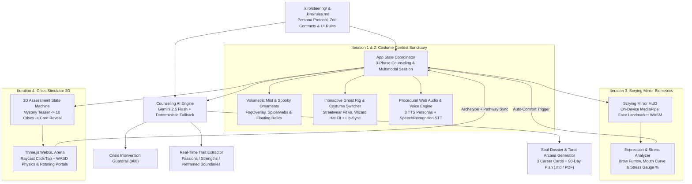

# System Design: The Friendly Ghost Career Counselor

## Architectural Overview

We designed the system incrementally across four core pillars so that conversational AI state, 2D/3D visual rendering, and on-device webcam computer vision remain cleanly decoupled:

---

## Key Design Decisions (By Iteration)

### Iteration 1: Steering-Driven State Machine & Dual-Engine AI
1. **Constraint-First Counseling State Machine (`COUNSELING_STAGES`)**:
   - Maps the 3 phases defined in `.kiro/steering/friendly_ghost_counselor_system_prompt.md` (`Phase 1: Reality Check`, `Phase 2: Energy & Environment`, `Phase 3: Skill Inventory`) into sequential stages while allowing unrestricted freeform Q&A at any turn.
2. **Dual-Engine AI Architecture with Zod Validation**:
   - **Primary Engine**: Google Gemini (`gemini-2.5-flash`) guided by the steering prompt and validated through `GhostResponseSchema` (`zod`) so malformed JSON never breaks the UI.
   - **Zero-Config Fallback Engine**: Built-in stage-aware counseling and answer-matching engine so judges and students get tailored answers and full 10-stage progression even without an API key.

### Iteration 2: Costume Contest Visual System & Multi-Voice Synthesis
1. **Interactive Costume Switcher & Lip-Sync Rig**:
   - Designed a layered SVG/CSS ghost rig supporting live outfit switching (**🎧 Streetwear Fit** vs. **🧙‍♂️ Wizard Hat Fit**), blinking eyes, mood-reactive aura rings, and real-time mouth openness driven by Web Speech synthesis boundaries.
2. **Victorian Editorial × Gothic Vaporwave Soul Dossier**:
   - Synthesizes extracted Passions, Strengths, and Reframed Boundaries into 3 **Tarot Career Arcana Cards** with salary outlooks, burnout protection, and a printable/downloadable First-90-Days checklist.

### Iteration 3: Privacy-First Scrying Mirror (Face, Mouth & Eyebrow Detection)
1. **Client-Side MediaPipe Face Landmarker Pipeline**:
   - Runs `@mediapipe/tasks-vision` completely in-browser via WebAssembly. Computes forehead/eyebrow muscle tension (`Brows: Relaxed` vs. `Furrowed`), mouth aperture and smile curves (`Mouth: Neutral / Smiling / Open`), and an aggregated **Stress Gauge (0–100%)**.
2. **Closed-Loop Biometric Empathy (`Auto-Comfort Mode`)**:
   - When the Stress Gauge crosses $\ge 38\%$ or detects sustained brow tension/frowning, the Scrying Mirror dispatches an `[Observed Expression]` event to the counseling engine, which automatically replies with grounding reassurance and softens TTS voice parameters (`softenVoice: true`).

### Iteration 4: Crisis Simulator 3D & Psychometric De-biasing
1. **Three.js WebGL Arena with Hybrid Raycast + Keyboard Controls**:
   - Renders an isometric 3D haunted arena with 4 glowing portal archways, floating text billboards, and a 3D spectral ghost avatar.
   - Supports **single Mouse Click / Touch Tap** navigation (via `THREE.Raycaster` intersecting portal meshes and the `y = 0` floor plane with a pulsing target ring) alongside **WASD / Arrow Key** velocity physics.
2. **Anti-Bias Mystery Cards & Color/Direction Rotation**:
   - **Pre-Test Secrecy**: The start screen displays 4 icon-driven locked mystery cards (`???`) rather than exposing `Maker`, `Architect`, `Catalyst`, and `Visionary` ahead of time.
   - **Per-Scenario Rotation**: Across the 10 crisis scenarios, each trait rotates across different compass directions (`top`, `bottom`, `left`, `right`) and portal colors (`#E74C3C`, `#3498DB`, `#F1C40F`, `#9B59B6`) so players never form a color or directional habit.
   - **Card-Based Pathway Sync**: Upon completing all 10 scenarios, recommended career pathways are presented as selectable cards that sync directly into the Ghost Counselor's conversation memory and unlock the Soul Dossier.
