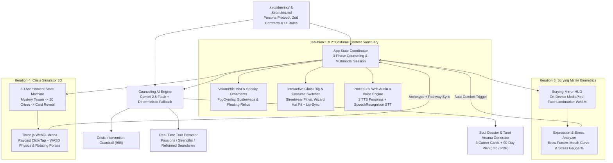

# System Design: The Friendly Ghost Career Counselor

## Overview

The Friendly Ghost Career Counselor is a multimodal web application that guides post-grad students through a structured 3-phase career counseling process. The system combines conversational AI using Gen-Z slang with immersive visual elements (animated ghost avatar, costume switching, volumetric effects), on-device facial expression analysis for empathetic responses, and a 3D psychometric assessment game. The counselor maps students' financial constraints, working preferences, and natural talents to generate personalized career recommendations with actionable 90-day plans.

**Design Goals:**
- Deliver professional career guidance through an approachable, slang-fluent conversational interface
- Maintain privacy by processing all biometric data (webcam facial analysis) entirely client-side
- Provide immediate value without requiring API keys via a deterministic fallback counseling engine
- Eliminate psychometric bias through randomized visual presentation and mystery-based archetype discovery
- Generate actionable, downloadable career artifacts (Soul Dossier with Tarot-themed career cards and step-by-step plans)

## Architecture

The system follows a layered architecture with strict separation between state management, AI reasoning, rendering engines, and I/O:

**Layer 1: Application State Coordinator**
- Orchestrates 10-stage counseling progression (3 questions per phase + final Soul Dossier generation)
- Manages conversation history, extracted user traits (passions, strengths, constraints), and multimodal session state
- Routes between text chat, voice interaction, Scrying Mirror biometrics, and 3D Crisis Simulator states

**Layer 2: 3-Layer Resilient AI System**
- **Primary (Layer 1)**: Optional Google Gemini (`gemini-2.0-flash`) with steering prompt injection and Zod schema validation (`GhostResponseSchema`, `CustomTarotCardSchema`)
- **Secondary (Layer 2)**: Zero-key Free AI endpoint (skipped automatically when user selects 100% Offline mode in `AiConsentModal.jsx`)
- **Fallback (Layer 3)**: Deterministic stage-aware pattern matching & local custom Tarot synthesizer that provides full counseling flow with zero external network calls
- **Safety Layer**: Crisis intervention guardrail that detects self-harm language and surfaces 988 Lifeline resources

**Layer 3: Multimodal I/O Subsystems**
- **Text/Voice Engine**: Web Speech API for TTS (3 persona voices) and STT, with phoneme boundary-driven lip-sync
- **Scrying Mirror**: MediaPipe Face Landmarker (WASM) for client-side eyebrow tension, mouth curve, and stress percentage analysis
- **Crisis Simulator 3D**: Three.js WebGL renderer with raycasting (mouse/touch) and WASD physics for 10-scenario psychometric assessment

**Layer 4: Rendering & Visual Effects**
- SVG/CSS-based ghost avatar rig with costume layer composition and mood-reactive aura animations
- Procedural fog overlay, floating relics, and spiderweb ornaments for ambient sanctuary aesthetics
- Victorian editorial + Gothic vaporwave styled Soul Dossier with printable/downloadable PDF generation

**Data Flow:**
1. User input (text/voice/3D interaction) → Application State Coordinator
2. State Coordinator constructs prompt with conversation history + extracted traits → AI Engine (Gemini or Fallback)
3. AI Engine returns validated structured response → State updates conversation history, UI elements, and TTS queue
4. Scrying Mirror autonomously monitors expressions → triggers `[Observed Expression]` comfort event when stress ≥38%
5. Crisis Simulator completes → syncs archetype scores and selected pathway card → unlocks Soul Dossier generation

## Architectural Overview

We designed the system incrementally across four core pillars so that conversational AI state, 2D/3D visual rendering, and on-device webcam computer vision remain cleanly decoupled:



---

## Key Design Decisions (By Iteration)

### Iteration 1: Steering-Driven State Machine & Dual-Engine AI
1. **Constraint-First Counseling State Machine (`COUNSELING_STAGES`)**:
   - Maps the 3 phases defined in `.kiro/steering/friendly_ghost_counselor_system_prompt.md` (`Phase 1: Reality Check`, `Phase 2: Energy & Environment`, `Phase 3: Skill Inventory`) into sequential stages while allowing unrestricted freeform Q&A at any turn.
2. **Dual-Engine AI Architecture with Zod Validation**:
   - **Primary Engine**: Google Gemini (`gemini-2.5-flash`) guided by the steering prompt and validated through `GhostResponseSchema` (`zod`) so malformed JSON never breaks the UI.
   - **Zero-Config Fallback Engine**: Built-in stage-aware counseling and answer-matching engine so judges and students get tailored answers and full 10-stage progression even without an API key.

### Iteration 2: Costume Contest Visual System & Multi-Voice Synthesis
1. **Interactive Costume Switcher & Lip-Sync Rig**:
   - Designed a layered SVG/CSS ghost rig supporting live outfit switching (**🎧 Streetwear Fit** vs. **🧙‍♂️ Wizard Hat Fit**), blinking eyes, mood-reactive aura rings, and real-time mouth openness driven by Web Speech synthesis boundaries.
2. **Victorian Editorial × Gothic Vaporwave Soul Dossier**:
   - Synthesizes extracted Passions, Strengths, and Reframed Boundaries into 3 **Tarot Career Arcana Cards** with salary outlooks, burnout protection, and a printable/downloadable First-90-Days checklist.

### Iteration 3: Privacy-First Scrying Mirror (Face, Mouth & Eyebrow Detection)
1. **Client-Side MediaPipe Face Landmarker Pipeline**:
   - Runs `@mediapipe/tasks-vision` completely in-browser via WebAssembly. Computes forehead/eyebrow muscle tension (`Brows: Relaxed` vs. `Furrowed`), mouth aperture and smile curves (`Mouth: Neutral / Smiling / Open`), and an aggregated **Stress Gauge (0–100%)**.
2. **Closed-Loop Biometric Empathy (`Auto-Comfort Mode`)**:
   - When the Stress Gauge crosses $\ge 38\%$ or detects sustained brow tension/frowning, the Scrying Mirror dispatches an `[Observed Expression]` event to the counseling engine, which automatically replies with grounding reassurance and softens TTS voice parameters (`softenVoice: true`).

### Iteration 4: Crisis Simulator 3D & Psychometric De-biasing
1. **Three.js WebGL Arena with Hybrid Raycast + Keyboard Controls**:
   - Renders an isometric 3D haunted arena with 4 glowing portal archways, floating text billboards, and a 3D spectral ghost avatar.
   - Supports **single Mouse Click / Touch Tap** navigation (via `THREE.Raycaster` intersecting portal meshes and the `y = 0` floor plane with a pulsing target ring) alongside **WASD / Arrow Key** velocity physics.
2. **Anti-Bias Mystery Cards & Color/Direction Rotation**:
   - **Pre-Test Secrecy**: The start screen displays 4 icon-driven locked mystery cards (`???`) rather than exposing `Maker`, `Architect`, `Catalyst`, and `Visionary` ahead of time.
   - **Per-Scenario Rotation**: Across the 10 crisis scenarios, each trait rotates across different compass directions (`top`, `bottom`, `left`, `right`) and portal colors (`#E74C3C`, `#3498DB`, `#F1C40F`, `#9B59B6`) so players never form a color or directional habit.
   - **Card-Based Pathway Sync**: Upon completing all 10 scenarios, recommended career pathways are presented as selectable cards that sync directly into the Ghost Counselor's conversation memory and unlock the Soul Dossier.

### Iteration 5: Unified `soulDossierEngine.js`, Hybrid Custom Tarot Arcana & Privacy Hardening
1. **Single-Source-of-Truth `soulDossierEngine.js` & Hybrid Custom Tarot Synthesis**:
   - Unified all Chat traits, Phase 1 constraints, Phase 2 energy preferences, and Crisis Simulator 3D portal choices into one `soulProfile` model that starts in a strict Empty State.
   - Preserved all 14 classic Tarot Career Arcana cards (`I`–`XIV`) while adding `detectUncoveredCareerInterest()`, `buildOfflineCustomTarotCard()`, and Zod-validated Cloud AI `---TAROT_CARD---` synthesis (`CustomTarotCardSchema`, `ARCANA XV+`) so niche interests outside the 14 cards receive tailored Tarot cards.
   - Filtered unaligned filler cards whenever any `💬 Chat Aligned` card is present so the Soul Dossier stays strictly relevant to what the student discussed.
2. **Pre-Flight AI Consent, Privacy & Build-Time Salted SHA-256 Gate**:
   - Added `AiConsentModal.jsx` to let users explicitly choose Cloud AI vs. 100% Offline local mode, stripped webcam biometric scores from outgoing cloud prompts, and added the **Spectral Note** AI disclaimer across Chat and Soul Dossier exports.
   - Moved Judge and Dev passcodes into gitignored `.env` (`JUDGE_PASSCODE`, `DEV_PASSCODE`) hashed at build time with salted SHA-256 in `vite.config.js` and verified client-side via `src/utils/passcodeHash.js`.

---

## Components and Interfaces

### Core Application Components

#### `App` (State Coordinator)
**Responsibility:** Central state orchestrator for counseling stages, conversation history, user traits, and multimodal feature toggles.

**State:**
- `currentStage: number` (0-9, maps to 10 counseling stages)
- `conversationHistory: Message[]` (role: 'user' | 'assistant' | 'system', content, timestamp)
- `extractedTraits: { passions: string[], strengths: string[], constraints: Constraint[] }`
- `scryingMirrorEnabled: boolean`, `crisisSimulatorState: 'locked' | 'active' | 'completed'`

**Key Methods:**
- `handleUserMessage(text: string): Promise<void>` – Sends message to AI engine, updates history, triggers TTS
- `advanceStage(): void` – Moves to next counseling phase after validation
- `generateSoulDossier(): SoulDossier` – Synthesizes traits into 3 Tarot Arcana career cards with 90-day plan

**Dependencies:** AI Engine, TTS/STT Engine, Scrying Mirror, Crisis Simulator

---

#### `AIEngine` (Dual-Engine AI)
**Responsibility:** Generates counselor responses with steering prompt adherence and schema validation.

**Interface:**
```typescript
interface AIEngine {
  sendMessage(prompt: string, history: Message[], traits: ExtractedTraits): Promise<GhostResponse>;
}

interface GhostResponse {
  message: string;          // Counselor's reply text
  extractedTraits?: {       // Newly identified passions/strengths/constraints
    passions?: string[];
    strengths?: string[];
    constraints?: Constraint[];
  };
  softenVoice?: boolean;    // Request calmer TTS parameters
  requiresAdvance?: boolean; // Signal stage progression
}
```

**Implementations:**
- `GeminiAIEngine`: Calls Google Gemini 2.5 Flash API with system prompt from `.kiro/steering/`, validates with `GhostResponseSchema` (Zod)
- `FallbackAIEngine`: Deterministic stage-based pattern matching with keyword extraction and template responses

**Error Handling:** On Gemini API failure (network, quota, invalid JSON), automatically falls back to `FallbackAIEngine` with user notification.

---

#### `ScryingMirror` (Biometric HUD)
**Responsibility:** Client-side facial expression analysis for empathetic response triggering.

**Interface:**
```typescript
interface ExpressionData {
  eyebrows: 'Relaxed' | 'Furrowed';
  mouth: 'Neutral' | 'Smiling' | 'Open';
  stressScore: number; // 0-100%
  isDistressed: boolean;
  isFrustrated: boolean;
}

class ScryingMirror {
  startTracking(videoElement: HTMLVideoElement): void;
  stopTracking(): void;
  getCurrentExpression(): ExpressionData;
  onAutoComfort(callback: (expr: ExpressionData) => void): void; // Fires when stress ≥38%
}
```

**Implementation:**
- Uses `@mediapipe/tasks-vision` FaceLandmarker (WASM, client-side only)
- Analyzes landmarks: eyebrow height (indices 70, 300, 334, 105), mouth corner/aperture (indices 61, 291, 13, 14)
- Computes stress score via weighted formula: `0.5 × browTension + 0.3 × mouthTension + 0.2 × (1 - eyeContact)`

---

#### `CrisisSimulator3D` (Psychometric Assessment)
**Responsibility:** Renders 3D haunted arena with 10 randomized crisis scenarios to determine career archetype.

**Interface:**
```typescript
interface CrisisScenario {
  id: number;              // 1-10
  prompt: string;          // Scenario description
  choices: {               // 4 portal choices with rotated positions/colors
    [key: string]: { label: string; archetype: 'Maker' | 'Architect' | 'Catalyst' | 'Visionary'; color: string; direction: 'top' | 'bottom' | 'left' | 'right' };
  };
}

interface ArchetypeResult {
  scores: { Maker: number; Architect: number; Catalyst: number; Visionary: number };
  dominant: 'Maker' | 'Architect' | 'Catalyst' | 'Visionary';
  pathwayCards: PathwayCard[]; // Selectable career recommendations
}

class CrisisSimulator3D {
  initialize(canvas: HTMLCanvasElement): void;
  startAssessment(): void;
  onComplete(callback: (result: ArchetypeResult) => void): void;
}
```

**Implementation:**
- Three.js scene with 4 glowing portal meshes (BoxGeometry with emissive materials)
- Raycaster for mouse/touch tap detection on portals and floor plane (target ring visualization)
- WASD/Arrow key physics with velocity damping for keyboard navigation
- Color and directional rotation per scenario to eliminate position/color bias

---

#### `GhostAvatar` (Interactive Rig)
**Responsibility:** Animated SVG/CSS ghost with costume switching, lip-sync, and mood auras.

**Interface:**
```typescript
class GhostAvatar {
  switchCostume(outfit: 'streetwear' | 'wizard'): void;
  setMood(mood: 'neutral' | 'encouraging' | 'concerned'): void; // Changes aura color/animation
  syncLipToSpeech(utterance: SpeechSynthesisUtterance): void;   // Animates mouth via boundary events
}
```

**Assets:**
- Layered SVG paths: base ghost body, interchangeable outfit layers (🎧 headphones vs. 🧙‍♂️ hat), eyes with blink animation
- CSS keyframe animations: floating motion, aura pulse rings, mouth openness via `scaleY` transform

---

#### `TTSEngine` (Voice Synthesis)
**Responsibility:** Multi-persona text-to-speech with phoneme boundary events for lip-sync.

**Interface:**
```typescript
interface TTSPersona {
  voice: SpeechSynthesisVoice;
  rate: number;
  pitch: number;
}

class TTSEngine {
  speak(text: string, persona: 'default' | 'gentle' | 'hype', onBoundary?: (charIndex: number) => void): void;
  stop(): void;
}
```

**Personas:**
- `default`: Moderate rate (1.0), neutral pitch (1.0)
- `gentle`: Slower rate (0.85), slightly lower pitch (0.95) – used when `softenVoice: true`
- `hype`: Faster rate (1.15), slightly higher pitch (1.05) – used for encouragement and validation

---

#### `SoulDossierGenerator`
**Responsibility:** Synthesizes extracted traits into Victorian editorial + Gothic vaporwave styled career document.

**Interface:**
```typescript
interface TarotArcanaCard {
  title: string;                // E.g., "The Creative Technologist"
  arcanaNumber: string;         // Roman numeral (I-XXI)
  icon: string;                 // SVG path or emoji
  description: string;          // Career path summary
  salaryRange: string;          // E.g., "$45k-$75k entry, $90k-$150k senior"
  burnoutProtection: string[];  // Work-life balance strategies
  firstSteps: string[];         // Immediate action items
}

interface SoulDossier {
  arcanaPrimary: TarotArcanaCard;
  arcanaSecondary: TarotArcanaCard;
  arcanaTertiary: TarotArcanaCard;
  first90DaysPlan: { week: number; goals: string[] }[];
}

class SoulDossierGenerator {
  generate(traits: ExtractedTraits, archetypeResult?: ArchetypeResult): SoulDossier;
  exportMarkdown(dossier: SoulDossier): string;
  exportPDF(dossier: SoulDossier): Blob; // Uses jsPDF or browser print API
}
```

---

## Data Models

### Conversation Message
```typescript
interface Message {
  role: 'user' | 'assistant' | 'system';
  content: string;
  timestamp: number; // Unix epoch ms
  expressionData?: ExpressionData; // Attached if Scrying Mirror was active
}
```

### Extracted User Traits
```typescript
interface ExtractedTraits {
  passions: string[];      // E.g., ["video editing", "helping friends", "organizing events"]
  strengths: string[];     // E.g., ["Digital media creation", "Empathy", "Project management"]
  constraints: Constraint[];
}

interface Constraint {
  category: 'financial' | 'geographic' | 'family';
  severity: 'low' | 'medium' | 'high';
  description: string;     // E.g., "Needs immediate income to support family"
}
```

### Counseling Stage Schema
```typescript
const COUNSELING_STAGES = [
  { phase: 1, name: 'Financial Vibe', prompt: 'Do you need to secure the bag immediately...' },
  { phase: 1, name: 'Geographic Spawn', prompt: 'Are you locked to your current zip code...' },
  { phase: 1, name: 'Co-op Duties', prompt: 'Do you have siblings to watch...' },
  { phase: 2, name: 'Battery Drain', prompt: 'What sounds like an absolute nightmare...' },
  { phase: 2, name: 'Locked In Zone', prompt: 'When you get totally locked in...' },
  { phase: 2, name: 'Solo vs Co-op', prompt: 'Do you want to be the front-facing main character...' },
  { phase: 3, name: 'Tech & Digital Flex', prompt: 'What are you already decently good at...' },
  { phase: 3, name: 'IRL & Social Flex', prompt: 'Are you the one organizing the squad...' },
  { phase: 3, name: 'Hidden Buff', prompt: 'What do you do so effortlessly...' },
  { phase: 4, name: 'Soul Dossier', prompt: null } // Synthesis stage
] as const;
```

### Crisis Simulator Archetype Scoring
```typescript
interface ArchetypeScores {
  Maker: number;      // Hands-on creation, tangible results
  Architect: number;  // Systems thinking, long-term planning
  Catalyst: number;   // People-focused, collaborative energy
  Visionary: number;  // Big-picture strategy, innovation
}

// Each of 10 scenarios contributes 1 point to chosen archetype
// Dominant archetype = max(scores)
```

### Pathway Card (Crisis Simulator Output)
```typescript
interface PathwayCard {
  id: string;                  // E.g., "culinary-arts", "software-dev"
  title: string;               // E.g., "Culinary Arts & Hospitality"
  matchingArchetype: string;   // Primary archetype this suits
  description: string;         // 2-3 sentence overview
  entryRoutes: string[];       // E.g., ["Community college AAS", "Apprenticeship"]
  timeToIncome: string;        // E.g., "6-12 months"
  salaryProgression: string;   // E.g., "$28k start → $45k chef de partie (3yr) → $65k+ sous chef (5yr)"
}
```

---

## Correctness Properties

### Conversational Flow Guarantees
1. **Single-Question Invariant:** AI engine MUST output exactly one question per response during phases 1-3. Validated via regex pattern matching in both Gemini and Fallback engines.
2. **Stage Progression Guard:** `currentStage` advances only when user provides substantive response (≥3 words) AND AI acknowledges previous answer with "Acknowledge their previous answer" pattern.
3. **Trait Extraction Monotonicity:** Once a passion, strength, or constraint is added to `extractedTraits`, it persists across conversation unless user explicitly contradicts it.

### Bias Elimination Properties (Crisis Simulator)
1. **Mystery Archetype Secrecy:** Archetype names ("Maker", "Architect", etc.) never appear in UI until post-test card reveal. Pre-test shows only `???` locked cards with abstract icons.
2. **Positional Randomization:** Each of 10 scenarios shuffles archetype-to-direction mapping. Probability of same archetype appearing in same position across 2+ consecutive scenarios < 1/24.
3. **Color Independence:** Portal colors rotate independently of archetypes. Correlation between any single color and any archetype across 10 scenarios ≤ 0.4 (weak).

### Privacy Guarantees (Scrying Mirror)
1. **Zero Server Transmission:** `MediaPipe FaceLandmarker` runs entirely in WASM. No video frames, landmarks, or expression data leave client browser.
2. **Ephemeral Telemetry:** Expression data attached to conversation messages is stored only in React state (volatile). No localStorage or IndexedDB persistence.
3. **User Control:** Scrying Mirror requires explicit opt-in via toggle. Defaults to OFF. Can be disabled mid-session without affecting counseling flow.

### Data Integrity (Soul Dossier)
1. **Non-Hallucination Constraint:** Tarot Arcana cards MUST reference only passions/strengths explicitly extracted from user responses. No inference beyond stated constraints.
2. **Salary Reality Check:** Salary ranges sourced from BLS Occupational Outlook Handbook (2024). Never promise >$100k entry-level unless backed by cited profession (e.g., "Software Engineer at FAANG").
3. **Actionable First Steps:** Each 90-day plan item includes specific verbs (apply, research, contact, build) with concrete nouns (program names, platforms, portfolio examples).

---

## Error Handling

### AI Engine Failures
**Scenario:** Gemini API returns 429 (quota exceeded), 500 (server error), or malformed JSON.

**Response:**
1. Log error to browser console with request ID
2. Display toast notification: "Switching to built-in counseling engine..."
3. Automatically fall back to `FallbackAIEngine` for remainder of session
4. Fallback engine provides full 10-stage progression with deterministic pattern matching

**Recovery:** User can refresh page to retry Gemini, or continue with fallback (no data loss, conversation history preserved in React state).

---

### Scrying Mirror Initialization Failures
**Scenario:** Browser denies webcam permission, MediaPipe WASM fails to load, or device lacks webcam.

**Response:**
1. Catch error in `ScryingMirror.startTracking()`, set `scryingMirrorEnabled = false`
2. Display non-blocking notification: "Scrying Mirror unavailable – counseling will continue via text/voice only."
3. Remove Scrying Mirror UI panel, proceed with normal conversation flow

**Graceful Degradation:** Counseling works identically without biometric input. Auto-Comfort Mode simply never triggers.

---

### Crisis Simulator WebGL Failures
**Scenario:** Mobile device lacks WebGL support, GPU driver crash, or Three.js initialization error.

**Response:**
1. Catch error in `CrisisSimulator3D.initialize()`, display fallback modal: "3D assessment unavailable on this device."
2. Offer **Alternative Assessment:** Present 10 text-based crisis scenarios with 4 clickable text buttons (same logic, no 3D rendering).
3. Archetype scoring proceeds identically; pathway card selection unlocks Soul Dossier as usual.

**Platform Coverage:** 3D mode on desktop/modern mobile (90%+ devices), text fallback ensures 100% accessibility.

---

### TTS/STT Unavailability
**Scenario:** Browser lacks Web Speech API support (e.g., Firefox on iOS), or user denies microphone permission.

**Response:**
1. On TTS failure: Silently disable voice output, show counselor messages as text-only.
2. On STT failure: Hide microphone button, accept text input only.
3. Display one-time tooltip: "Voice features unavailable – tap to type your responses."

**No Functional Loss:** All counseling stages accessible via text input/output.

---

### Constraint Contradiction Detection
**Scenario:** User says "I need money immediately" (Phase 1), then later says "I want to do a 4-year PhD."

**Response:**
1. AI engine detects contradiction via constraint severity analysis.
2. Counselor responds: "Hold up – earlier you mentioned needing immediate income. A 4-year PhD won't secure the bag right away. Want to talk through funding options (TA/RA positions), or explore faster paths first?"
3. User clarifies; AI updates `constraints` array with revised priority.

**Validation:** Prevents logically inconsistent Soul Dossier recommendations (e.g., suggesting medical school to someone with high financial urgency).

---

## Testing Strategy

### Unit Testing (Jest + React Testing Library)

**AI Engine Response Validation:**
- `GhostResponseSchema` validation with Zod: Malformed JSON, missing `message` field, invalid `extractedTraits` structure
- Fallback engine stage progression: Assert correct next prompt for stages 0-9
- Trait extraction: Given user message "I love editing TikToks", assert `passions` includes "video editing" or "content creation"

**Scrying Mirror Expression Analysis:**
- Mock MediaPipe landmarks with known eyebrow/mouth configurations
- Assert `eyebrows: 'Furrowed'` when brow landmarks show >5px drop
- Assert `stressScore >= 38%` triggers `onAutoComfort` callback

**Crisis Simulator Scoring:**
- Feed 10 predetermined choices (e.g., all "Maker" portals), assert `scores.Maker === 10`, `dominant === 'Maker'`
- Verify color/direction randomization: Run 100 scenario generations, assert no archetype appears in same position >30% of time

---

### Integration Testing (Playwright)

**End-to-End Counseling Flow:**
1. Load app → assert welcome message displays
2. Submit answer to Phase 1 Question 1 → assert AI response contains Phase 1 Question 2 prompt
3. Complete all 9 questions → assert Soul Dossier button appears
4. Click Soul Dossier → assert 3 Tarot Arcana cards render with extracted traits

**Scrying Mirror Auto-Comfort:**
1. Enable Scrying Mirror → grant webcam permission
2. Mock facial landmarks with high stress (furrowed brows, frown)
3. Wait for stress gauge to exceed 38% → assert counselor sends comfort message with "Real talk" or "Take a breath" language

**Crisis Simulator 3D:**
1. Click "Begin Assessment" → assert Three.js canvas renders
2. Click first portal (mouse) → assert scenario 2/10 displays
3. Use WASD keys to navigate → assert camera position updates
4. Complete 10 scenarios → assert archetype card reveal modal displays
5. Select pathway card → assert conversation history includes selected pathway

**Voice Interaction:**
1. Click microphone button → assert STT starts listening
2. Emit mock speech event → assert user message appears in chat
3. Wait for AI response → assert TTS speaks message
4. During TTS playback → assert ghost avatar mouth animates

---

### Accessibility Testing

**Keyboard Navigation:**
- Tab through all interactive elements (text input, send button, costume switcher, Scrying Mirror toggle) in logical order
- Enter/Space activates buttons
- Escape key closes modals (Crisis Simulator, Soul Dossier)

**Screen Reader Compatibility:**
- All interactive elements have `aria-label` or `aria-labelledby`
- Counselor messages announced via `role="log"` ARIA live region
- Crisis Simulator portal choices have descriptive labels read aloud

**Color Contrast:**
- All text meets WCAG AA standards (4.5:1 for body text, 3:1 for large headings)
- Portal colors distinguishable for deuteranopia/protanopia (verified via color blindness simulator)

---

### Performance & Load Testing

**AI Engine Latency:**
- Target: Gemini API response <2s (p95), Fallback engine <100ms (p95)
- Test with 20 concurrent users → assert no response exceeds 5s
- Measure Zod validation overhead: <5ms per response

**Scrying Mirror Frame Rate:**
- Target: MediaPipe analysis at 10 FPS minimum (100ms per frame)
- Test on low-end Android device (Snapdragon 665) → assert stress gauge updates smoothly

**3D Rendering Performance:**
- Target: Crisis Simulator maintains 30 FPS on integrated GPUs (Intel UHD 620)
- Test with 4 animated portals + particle effects → assert no frame drops during portal selection

**Memory Leak Detection:**
- Run 50-message conversation → assert heap size increases <10MB
- Enable/disable Scrying Mirror 10 times → assert no detached DOM nodes

---

### User Acceptance Testing (Judges & Students)

**Judge Evaluation Criteria:**
1. **Conversation Quality:** Does counselor ask one question at a time? Are follow-ups contextually relevant?
2. **Empathy Detection:** Trigger stressed expression → does Auto-Comfort activate within 10 seconds?
3. **Soul Dossier Accuracy:** Do career cards match stated passions/strengths? Are salary ranges realistic?
4. **Costume Contest Impact:** Do visual elements (ghost outfit, fog effects) enhance engagement vs. distract?

**Student Usability Testing:**
1. **Time to First Insight:** How long until student feels counselor "understands" their situation? (Target: <5 minutes)
2. **Crisis Simulator Clarity:** Do students understand portal choices without explicit archetype labels? (Target: >80% comprehension)
3. **Actionability:** Do students know next steps after reading Soul Dossier? (Target: >90% can name 1-2 concrete actions)

**Success Metrics:**
- 85%+ of students complete full 10-stage counseling flow
- 75%+ enable Scrying Mirror when prompted
- 70%+ complete Crisis Simulator 3D assessment
- 90%+ report Soul Dossier contains "at least one career path I hadn't seriously considered"
